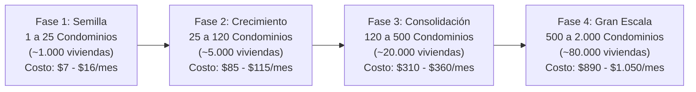

# Estudio de Costos de Infraestructura, Escalamiento y Modelo de Monetización — IA Condo

**Empresa:** SOLUCIONES DIGITALES CREAPPTIVAS C.A. (`RIF: J508901061`)  
**Plataforma:** IA Condo ([`iacondo.com`](file:///Users/alejandro/.gemini/antigravity/scratch/MisProyectos/iacondo-website/src/App.jsx), [`app.iacondo.com`](file:///Users/alejandro/.gemini/antigravity/scratch/MisProyectos/condopro/src/App.jsx), [`condopro-backend`](file:///Users/alejandro/.gemini/antigravity/scratch/MisProyectos/condopro-backend/server.js))

---

## 1. Radiografía Técnica Actual y Dónde se Generan los Costos

Actualmente el ecosistema de **IA Condo** opera sobre cuatro capas tecnológicas. No todas las acciones de un usuario cuestan lo mismo: **guardar texto contable es casi gratis, pero guardar imágenes/PDFs y ejecutar agentes de IA o WhatsApp tiene un costo directo por operación.**

| Capa Tecnológica | Proveedor Actual | Plan / Capacidad Actual | Qué consume recursos realmente |
| :--- | :--- | :--- | :--- |
| **1. Base de Datos** | **MongoDB Atlas** | **M0 Free** (`512 MB` RAM/Disco, 500 conexiones) | Documentos JSON de apartamentos, pagos, gastos, cierres mensuales, pases de garita y Cartas Consulta. |
| **2. Servidor Backend & IA** | **Render.com** | **Web Service** (`512 MB` RAM / CPU compartida) | Procesamiento de extractos en PDF/Excel (`pdf-parse`, `xlsx`), sesión de WhatsApp y llamadas a la API de IA. |
| **3. Almacenamiento de Archivos** | **Disco Local (`/uploads`) / Base64** | Efímero en contenedor ([`condoRoutes.js`](file:///Users/alejandro/.gemini/antigravity/scratch/MisProyectos/condopro-backend/routes/condoRoutes.js#L16-L28)) | Fotos de facturas, capturas de Pago Móvil/Zelle, PDFs de presupuestos de Cartas Consulta y actas. |
| **4. Inteligencia Artificial y Mensajería** | **Google Gemini Flash + WhatsApp / Email / Push** | Pago por consumo (`Pay-as-you-go`) | Lectura OCR de facturas/comprobantes con visión IA, conciliación bancaria predictiva y respuestas del Agente IA 24/7. |
| **5. Frontend Web y Panel** | **Vercel** | Hobby / Pro (CDN Global) | Descarga de la aplicación web estática (costo marginal cercano a `$0`). |

> [!CAUTION]
> **El mayor riesgo técnico actual (Imágenes y PDFs):**  
> En [`condopro-backend/server.js`](file:///Users/alejandro/.gemini/antigravity/scratch/MisProyectos/condopro-backend/server.js#L44-L48), las imágenes y PDFs subidos a `/uploads` se guardan en el disco local del contenedor de Render (que se borra cada vez que el servidor se actualiza o reinicia), o bien viajan en Base64 dentro de MongoDB (`limit: '25mb'`).  
> - **1 pago en texto puro** ocupa **`2.5 KB`** (caben **200.000 pagos** en los `512 MB` gratuitos de MongoDB).  
> - **1 sola foto de factura o captura de pago** pesa **`~400 KB`** (equivale a **160 pagos en texto**). Con apenas **1.200 fotos** guardadas dentro de MongoDB se agota toda la base de datos.  
> **Solución inmediata antes de escalar:** Separar las imágenes/PDFs a **Cloudflare R2** (almacenamiento en la nube compatible con S3), que incluye **10 GB gratis al mes**, cobra solo **`$0.015 USD por GB adicional`** y tiene **`$0.00` de costo por descargas/visualizaciones**.

---

## 2. Costo Unitario Real por Operación (Unit Economics)

Para fijar los precios de los planes, primero debemos saber cuánto nos cuesta en dólares cada acción que realiza un condominio o un vecino dentro de la plataforma:

| Tipo de Operación / Dato | Peso / Consumo Técnico | Costo Unitario Real (USD) | Costo por cada 1.000 Operaciones |
| :--- | :--- | :--- | :--- |
| **Registro en Base de Datos (Texto)** *(1 pago, 1 gasto, 1 pase QR, 1 voto LPH)* | `~2 KB a 5 KB` en MongoDB | **`$0.000001 USD`** | **`$0.001 USD`** *(0.1 centavos)* |
| **Almacenamiento de 1 Imagen Comprimida o PDF** *(Factura, captura, presupuesto en Cloudflare R2)* | `~250 KB` (optimizado a WebP) | **`$0.000004 USD / mes`** | **`$0.004 USD / mes`** *(0.4 centavos)* |
| **Lectura IA de 1 Factura, Captura o Extracto** *(Visión + Extracción con Gemini 2.5 Flash)* | `~1.800 tokens` entrada + `400` salida | **`$0.00045 USD`** | **`$0.45 USD`** *(45 centavos)* |
| **1 Mensaje de Chat con el Agente IA (Carlos / Sofía)** *(Consulta de deuda, área común, reclamo)* | `~1.200 tokens` de contexto + respuesta | **`$0.00025 USD`** | **`$0.25 USD`** *(25 centavos)* |
| **Migración Inicial Completa con IA (Onboarding)** *(Lectura de Excel de vecinos + PDF bancario)* | `~25.000 tokens` por condominio | **`$0.015 USD`** (pago único) | **`$15.00 USD`** (por 1.000 condominios) |
| **Notificación Push a la App / Celular** *(Llegada de visitante a garita, aviso de cobro)* | Protocolo `web-push` directo | **`$0.00 USD`** (Gratis) | **`$0.00 USD`** |
| **Correo Electrónico Transaccional** *(Recibo mensual, código de seguridad)* | API SMTP / Resend / AWS SES | **`$0.0004 USD`** | **`$0.40 USD`** |

### ¿Cuánto nos cuesta mantener 1 Condominio Promedio (50 viviendas) al mes?

1. **Si está en el Plan Gratis (restringido a operaciones manuales y sin IA continua):**
   - Genera `~60` registros de texto al mes (`~200 KB` en MongoDB) y usa notificaciones Web Push (`$0`).
   - **Costo mensual para nuestra empresa:** **`~$0.02 USD / mes`** (2 centavos de dólar al mes).
2. **Si está en el Plan Premium IA (con uso intensivo de IA, fotos y WhatsApp):**
   - `50` pagos conciliados con IA + `25` facturas escaneadas con foto + `300` mensajes de vecinos al Agente IA en WhatsApp + `150` pases de garita + `50 MB` de imágenes/PDFs nuevos al mes.
   - **Costo variable de IA + Almacenamiento:** `~$0.15 USD` (IA) + `$0.02 USD` (R2/DB) + `$0.10 USD` (Emails) = **`~$0.27 a $0.45 USD / mes`** (más su fracción del servidor).

---

## 3. Fases de Expansión: ¿Cuándo Mejorar de Proveedor y Cuánto Cuesta "Tenerlo en Grande"?

### Tabla de Umbrales de Actualización y Costos Mensuales de Infraestructura

| Fase de la Empresa | Volumen Activo | Señal de Alerta (Cuándo actualizar) | Infraestructura Requerida y Mejoras de Seguridad | Costo Mensual Total (USD) |
| :--- | :--- | :--- | :--- | :--- |
| **Fase 1: Actual / Semilla** | **1 a 25 condominios** *(~1.000 viviendas)* | Inmediato: migrar fotos de `/uploads` a **Cloudflare R2** para no perder imágenes al reiniciar Render. | • **MongoDB Atlas:** M0 (`$0`) • **Render Backend:** Starter (`$7/mes`) • **Cloudflare R2:** 10 GB gratis (`$0`) • **Gemini IA:** Consumo bajo (`~$5/mes`) | **`$12 – $16 / mes`** |
| **Fase 2: Crecimiento Comercial** | **25 a 120 condominios** *(~5.000 viviendas)* | • MongoDB supera los **`350 MB`** (70% de M0). • Más de **3 juntas** subiendo extractos al mismo tiempo (RAM > 80%). | • **MongoDB Atlas M10 Dedicado (`$57/mes`):** Incluye **Backups automáticos diarios**, aislamiento de red y `10 GB` de disco. • **Render Standard (`$25/mes`):** `2 GB RAM` + `1 CPU` dedicada. • **Cloudflare R2 (`50 GB`):** `$0.75/mes` • **Gemini IA + Emails:** `~$20/mes` | **`$95 – $115 / mes`** |
| **Fase 3: Escala Media** | **120 a 500 condominios** *(~20.000 viviendas)* | • Más de **1.500 usuarios conectados** en horas pico (7pm–10pm). • Más de **5.000 mensajes de WhatsApp IA** al día. | • **MongoDB Atlas M20 (`$140/mes`):** Réplica en 3 nodos (si un servidor falla, entra otro en 2 segundos sin caída). • **Render Pro (`$85/mes`):** `4 GB RAM` + 2 instancias con balanceador. • **Cloudflare R2 (`300 GB`):** `$4.50/mes` • **Gemini IA + WhatsApp Cloud API + SES:** `~$110/mes` | **`$320 – $360 / mes`** |
| **Fase 4: "Tenerlo en Grande" (Nacional / LatAm)** | **500 a 2.000 condominios** *(~80.000 viviendas)* | • Operación crítica 24/7 con auditoría bancaria y miles de accesos de garita por hora. | • **MongoDB Atlas M30 (`$380/mes`):** Recuperación punto-en-el-tiempo (*Point-in-Time Recovery* al segundo exacto) y cifrado avanzado. • **Cluster Backend Auto-escalable (`$220/mes`)** + **Redis Cache (`$25/mes`)**. • **Cloudflare R2 (`1.5 TB` de bóveda 5 años):** `$22.50/mes` • **Cloudflare WAF Pro (`$20/mes`):** Blindaje anti-hackeo y DDoS. • **IA & Mensajería Masiva:** `~$280/mes` | **`$900 – $1.050 / mes`** |

> [!IMPORTANT]
> **Conclusión clave de infraestructura:**  
> Tener la plataforma **"en grande"** soportando **2.000 condominios (~80.000 familias)** con seguridad bancaria, respaldos al segundo y alta disponibilidad cuesta alrededor de **`$950 USD al mes`** en total. Eso significa que a gran escala cada condominio nos cuesta apenas **`$0.47 USD al mes`** de infraestructura.

---

## 4. Estrategia de Monetización: El Modelo Híbrido (Viviendas + Operaciones / IA)

Tu planteamiento de cobrar en función de **dos variables combinadas (1. Número de viviendas y 2. Volumen de operaciones/IA al mes)** es exactamente la fórmula más rentable y justa por dos razones:

1. **Justicia por tamaño (Número de Viviendas):** Para una junta de condominio es muy fácil aprobar un gasto cuando equivale a **`$0.60 – $0.90 USD al mes por vivienda`** dentro del recibo mensual. Para un propietario pagar `$0.75` al mes por tener garita digital, pases QR, reservas y cuentas claras es insignificante, pero para **IA Condo** representa entre **`$19 y $99 USD mensuales por edificio`**.
2. **Protección de costos variables (Límite de Operaciones, Imágenes e IA):** Al establecer un tope mensual de operaciones de IA y almacenamiento en cada plan, evitamos que un condominio pequeño haga un uso abusivo de lecturas de IA o suba miles de fotos sin pasar al siguiente nivel o comprar un paquete adicional.

### Reglas de Oro del Plan Gratuito (Para que cueste `< $0.03/mes` y convierta a Pago)

Para que cientos de comunidades puedan usar el **Plan Comunidad Gratis** sin generar pérdidas técnicas y al mismo tiempo sientan el deseo de subir al Plan Pago:

1. **30 Días de Bienvenida con Todo Ilimitado:** Al registrarse, prueban el Agente IA, la conciliación automática y la lectura de facturas durante 30 días (nos cuesta solo `~$0.05 USD` de IA por ese mes de prueba). Allí toda la Junta y los vecinos se acostumbran a la comodidad.
2. **Límites Técnicos del Plan Gratis (a partir del día 31):**
   - **Hasta 20 viviendas** sin costo, o bien para conjuntos mayores únicamente en **Modo Manual Básico**.
   - **Hasta 50 operaciones manuales/mes** (registro manual de pagos y gastos en texto, sin escaneo OCR por IA).
   - **Sin almacenamiento permanente de imágenes pesadas:** Los pagos se reportan con número de referencia, banco, fecha y monto en texto (`2 KB`). Si suben captura de pantalla, se conserva solo por **15 días** mientras la Junta concilia el pago y luego se libera el espacio automáticamente.
   - **Hasta 30 pases de visita digitales al mes** en Garita (con alertas Web Push gratuitas; sin alertas por WhatsApp).
   - **0 créditos de Agente IA en WhatsApp** (el vecino consulta su saldo entrando a la App web, no por WhatsApp automático).

---

## 5. Estructura Propuesta de Planes y Precios (B2B SaaS para Condominios)

A continuación se presenta la matriz recomendada combinando **Viviendas + Operaciones/IA**:

| Característica / Límite Mensual | 🌱 Plan Comunidad Gratis | 🏘️ Plan Residencial (Básico) | 🚀 Plan Condominio Pro IA *(Más Popular)* | 🏢 Plan Gran Conjunto / Administradora |
| :--- | :--- | :--- | :--- | :--- |
| **Precio Mensual Sugerido** | **`$0 / mes`** *(Gratis siempre)* | **`$19 / mes`** *(o `$190/año`)* | **`$39 / mes`** *(o `$390/año`)* | **`$79 / mes`** *(hasta 200 viv. / `+$0.35` viv. extra)* |
| **Costo por Vivienda para los Vecinos** | `$0.00 / casa` | `~$0.63 / vivienda` | `~$0.39 – $0.55 / vivienda` | `~$0.35 – $0.39 / vivienda` |
| **1. Límite de Viviendas (Unidades)** | **Hasta 20 viviendas** *(o uso manual básico)* | **Hasta 30 viviendas** | **De 31 a 100 viviendas** | **De 101 a 200+ viviendas** *(Multi-torre / Urbanismos)* |
| **2. Operaciones Contables / mes** *(Pagos + Gastos + Movimientos)* | **Hasta 50 / mes** *(100% manuales)* | **Hasta 150 / mes** | **Hasta 500 / mes** | **Ilimitadas** *(+2.000 / mes)* |
| **3. Lecturas con IA / mes** *(Escaneo de facturas, capturas y extractos)* | **0 / mes** *(Tras los 30 días de regalo)* | **50 lecturas IA / mes** | **200 lecturas IA / mes** | **600 lecturas IA / mes** |
| **4. Mensajes del Agente IA en WhatsApp** *(Atención automática 24/7 a vecinos)* | No incluido *(Solo consulta en App)* | **300 mensajes IA / mes** | **1.000 mensajes IA / mes** | **3.500 mensajes IA / mes** |
| **5. Pases QR y Accesos de Garita / mes** | Hasta **30 pases / mes** | **300 pases / mes** + Mando Portón | **Ilimitados** + Alertas en vivo | **Ilimitados** + Múltiples Garitas |
| **6. Bóveda de Imágenes y PDFs** *(Facturas, recibos, Cartas Consulta)* | Retención temporal **15 días** (`50 MB`) | Retención **1 año** (`1 GB`) | Bóveda Legal **3 años** (`5 GB`) | Bóveda Forense **5 años** (`20 GB`) |
| **7. Cuentas Bancarias / Cajas** | Máximo **2 cuentas** | Hasta **4 cuentas / cajas** | **Ilimitadas** + Auditoría Forense | **Ilimitadas** + API / Exportación Excel |
| **Costo Técnico Real para Nosotros** | **`~$0.02 / mes`** | **`~$0.22 / mes`** | **`~$0.45 / mes`** | **`~$1.10 / mes`** |
| **Margen Bruto para IA Condo** | Lead / Canal Viral | **`98.8%` (`+$18.78/mes`)** | **`98.8%` (`+$38.55/mes`)** | **`98.6%` (`+$77.90/mes`)** |

---

## 6. Micro-Monetización (Recargas y Extras para Usuarios Gratis y Pagos)

Además de los planes mensuales, podemos permitir que cualquier condominio (incluso los del **Plan Gratis** que no quieran comprometerse a una mensualidad fija) compre **Paquetes Puntuales por Operación (Pay-As-You-Go)**:

1. **⚡ Paquete "Cierre de Mes con IA" (`$5 USD` recarga única):**
   - Otorga **60 lecturas de IA** (para subir el extracto bancario del mes, escanear las facturas y conciliar todos los pagos en segundos) + **30 días de conservación de los soportes de ese cierre**.
   - *Ideal para juntas en el Plan Gratis que solo quieren pagar `$5` a fin de mes para no transcribir el cierre a mano.*
   - **Nuestro costo real:** `$0.04 USD` → **Ganancia neta: `$4.96 USD`**.
2. **🗳️ Paquete "Carta Consulta LPH Blindada" (`$7 USD` por consulta formal o incluido en Pro):**
   - Permite adjuntar múltiples presupuestos en PDF con fotos, envío masivo de notificaciones a propietarios y generación del Acta Oficial auditable con respaldo de 3 años.
3. **💬 Recarga de 500 Mensajes de Agente IA WhatsApp + 2 GB de Bóveda (`$9 USD`):**
   - Si un condominio tuvo un mes de mucha actividad (asambleas, obras extraordinarias) y consumió su cuota mensual de IA, puede recargar un paquete adicional en un clic sin cambiar de plan.
4. **🛠️ Comisión / Monetización Cruzada con `Profesional Cercano`:**
   - Incluso los condominios en el **Plan Gratis** publican sus averías de plomería, electricidad, bombas hidroneumáticas o impermeabilización conectadas con **`profesionalcercano.com`**. Esto alimenta de clientes reales de alto valor a los profesionales suscritos en **Profesional Cercano (Planes PRO/ELITE)**, monetizando indirectamente a las comunidades gratuitas.

---

## 7. Estructura de Gastos Reales de la Compañía y Punto de Equilibrio (Break-Even)

Para conocer el **Punto de Equilibrio real de `SOLUCIONES DIGITALES CREAPPTIVAS C.A.`** (el momento exacto en que los ingresos mensuales cubren el 100% de la operación sin poner dinero de tu bolsillo), sumamos los costos de servidores/IA más tus gastos fijos tecnológicos, un **equipo base de 3 personas** y los gastos administrativos normales de toda empresa en Venezuela:

### A. Presupuesto Mensual Operativo Completo (OPEX + Infraestructura)

| Categoría de Gasto | Concepto Detallado | Costo Mensual (USD) |
| :--- | :--- | :--- |
| **1. Herramientas IA & Conectividad** | • Plan Personal de Desarrollo y Agentes IA Pro (`$100/mes`) • Internet Fibra Óptica Dedicado + Datos de Respaldo (`$50/mes`) • Dominios, DNS y Correos Corporativos (`$15/mes`) | **`$165 / mes`** |
| **2. Servidores, Base de Datos y API IA** | • MongoDB Atlas Dedicado (`$57`) + Render Backend (`$25`) • Cloudflare R2 Bóveda de Imágenes (`$3`) + Consumo API Gemini Flash (`$20`) *(Capacidad suficiente para soportar hasta ~250 condominios activos)* | **`$105 / mes`** |
| **3. Equipo Humano Base (3 Personas)** | • **Persona 1 (Comercial / Closer de Condominios y Calles Cerradas):** `$400/mes` base • **Persona 2 (Onboarding IA y Éxito del Cliente / Soporte Juntas):** `$350/mes` • **Persona 3 (Operaciones, Redes Sociales y Administración):** `$350/mes` | **`$1.100 / mes`** |
| **4. Gastos Normales de Compañía (Venezuela)** | • **Honorarios de Contador y Declaraciones SENIAT / Alcaldía:** `$80/mes` • **Publicidad Digital (Meta Ads / Instagram para captar Juntas):** `$200/mes` • **Movilización, visitas a urbanizaciones y material QR de garitas:** `$100/mes` • **Comisiones bancarias, papelería, tributos mínimos e imprevistos:** `$80/mes` | **`$460 / mes`** |
| **TOTAL GASTOS MENSUALES DE LA EMPRESA** | **Gasto Total Mensual Fijo + Operativo (Meta de Punto de Equilibrio)** | **`$1.830 USD / mes`** *(~$2.000/mes con holgura)* |

---

### B. ¿Con Cuántos Condominios Pagos Alcanzamos el Punto de Equilibrio?

Tomando los precios oficiales publicados en [`iacondo.com`](file:///Users/alejandro/.gemini/antigravity/scratch/MisProyectos/iacondo-website/src/App.jsx#L642-L793) (**`$19`** Residencial Básico, **`$39`** Condominio Pro IA y **`$79`** Gran Conjunto / Admin):

- **Distribución esperada de clientes pagos:**
  - **45%** en Plan Residencial Básico (`$19/mes` — calles cerradas y edificios pequeños)
  - **45%** en Plan Condominio Pro IA (`$39/mes` — conjuntos de 31 a 100 viviendas)
  - **10%** en Plan Gran Conjunto (`$79/mes` — conjuntos de +100 viviendas)
- **Ticket Promedio Ponderado por Condominio Pago (ARPU):**
  $$0.45(\$19) + 0.45(\$39) + 0.10(\$79) = \mathbf{\$34.00\text{ USD / mes}}$$

$$\text{Punto de Equilibrio} = \frac{\$1.830\text{ a }\$2.000\text{ USD de gastos mensuales}}{\$34.00\text{ USD por condominio pago}} = \mathbf{54\text{ a }59\text{ condominios pagos}}$$

| Escenario de Mezcla de Planes | Cantidad Exacta para Cubrir los `$1.830 - $2.000/mes` | Ingreso Mensual Generado (MRR) |
| :--- | :--- | :--- |
| **Mezcla Realista Combinada (Recomendada)** | **56 comunidades pagas:** • `25` en Plan Básico (`$19`) = `$475` • `25` en Plan Pro IA (`$39`) = `$975` • `6` en Plan Gran Conjunto (`$79`) = `$474` | **`$1.924 USD / mes`** *(Punto de equilibrio superado)* |
| **Si fueran solo Planes Condominio Pro IA (`$39`)** | **48 condominios** en Plan Pro IA | **`$1.872 USD / mes`** |
| **Si fueran solo Calles Cerradas Pequeñas (`$19`)** | **97 calles cerradas** en Plan Básico | **`$1.843 USD / mes`** |
| **Si fueran solo Grandes Conjuntos (`$79`)** | **24 grandes conjuntos** en Plan Gran Conjunto | **`$1.896 USD / mes`** |

---

### C. Línea de Tiempo Mes a Mes: ¿Cuándo Llegamos al Punto de Equilibrio?

Considerando que cada comunidad nueva recibe **30 días de bienvenida con IA gratis** antes de pagar su primera mensualidad, y asumiendo que el equipo de 3 personas + Sofía IA activa **40 comunidades al mes** (solo ~1.3 diarias) con una conversión del **35% a plan pago (`14` nuevos clientes pagos por mes)** más unas **10 recargas puntuales de `$5`** de las comunidades gratuitas:

| Mes de Operación | Comunidades Totales Acumuladas | Comunidades en Plan Gratis / Prueba (65%) | Comunidades Pagando Plan Mensual (`$34` prom.) | Ingresos Mensuales Totales (Planes + Recargas) | Gastos Totales de la Empresa (Equipo + IA + Internet + Cloud) | Flujo de Caja Neto del Mes (Resultado) |
| :--- | :--- | :--- | :--- | :--- | :--- | :--- |
| **Mes 1** *(Lanzamiento)* | 40 | 40 *(en sus 30 días gratis)* | **0** | **`$50`** | `$1.750` | `-$1.700` *(Inversión inicial)* |
| **Mes 2** | 80 | 66 | **14 pagos** | **`$526`** | `$1.780` | `-$1.254` |
| **Mes 3** | 120 | 92 | **28 pagos** | **`$1.022`** | `$1.800` | `-$778` |
| **Mes 4** | 160 | 118 | **42 pagos** | **`$1.518`** | `$1.830` | `-$312` *(Casi en equilibrio)* |
| **🟢 Mes 5 (EQUILIBRIO)** | **200** | **144** | **56 pagos** | **`$2.014 / mes`** | **`$1.830 / mes`** | **`+$184 / mes` (Punto de Equilibrio alcanzado)** |
| **Mes 6** | 240 | 170 | **70 pagos** | **`$2.510 / mes`** | `$1.860 / mes` | **`+$650 / mes`** *(Utilidad neta)* |
| **Mes 9** | 360 | 248 | **112 pagos** | **`$4.008 / mes`** | `$2.150 / mes` | **`+$1.858 / mes`** *(Utilidad neta)* |
| **Mes 12 (Año 1)** | **480** | **312** | **168 pagos** | **`$5.960 / mes`** | **`$2.450 / mes`** | **`+$3.510 / mes`** *(Utilidad neta libre)* |

> [!TIP]
> **Capital de trabajo necesario hasta alcanzar el Punto de Equilibrio (Meses 1 al 4):**  
> La suma acumulada del déficit de los primeros 4 meses mientras las primeras cohortes cumplen sus 30 días de prueba y se acumulan los primeros 56 clientes pagos es de apenas **`~$4.044 USD`** (`$1.700 + $1.254 + $778 + $312`). A partir del **Mes 5**, la empresa se paga 100% sola (incluyendo tu plan de IA de `$100`, tu internet de `$50`, los servidores y los 3 sueldos) y empieza a generar ganancias netas crecientes todos los meses.

---

## 8. Plan de Acción Técnico Recomendado (Próximos Pasos)

Para dejar la plataforma lista para controlar estos costos automáticamente desde el código:

1. **Paso 1 — Añadir el control de Plan y Cuotas Mensuales en el modelo [`Condominium.js`](file:///Users/alejandro/.gemini/antigravity/scratch/MisProyectos/condopro-backend/models/Condominium.js):**
   - Agregar el bloque `subscription` en cada condominio con:
     - `plan`: `'trial_ai'` (primeros 30 días) | `'free'` | `'basic'` (`$19`) | `'pro'` (`$39`) | `'enterprise'` (`$79`)
     - `trialEndsAt`: Fecha automática `createdAt + 30 días`
     - `limits`: `{ maxUnits, maxMonthlyOperations, maxMonthlyAiScans, maxMonthlyAiChats, storageLimitMB }`
     - `usageThisMonth`: `{ monthKey, operationsCount, aiScansCount, aiChatsCount, storageUsedMB }`
2. **Paso 2 — Mostrar la Calculadora de Planes en [`iacondo.com`](file:///Users/alejandro/.gemini/antigravity/scratch/MisProyectos/iacondo-website/src/App.jsx#L445-L574) y el Medidor de Consumo en [`app.iacondo.com`](file:///Users/alejandro/.gemini/antigravity/scratch/MisProyectos/condopro/src/App.jsx):**
   - Que la Junta pueda deslizar cuántas viviendas tiene su condominio en la web y ver de inmediato cuánto le cuesta por vivienda al mes (`ej. 40 casas = $0.72 por casa al mes`), junto con su barra de consumo mensual de operaciones e IA dentro del panel.
3. **Paso 3 — Conectar Cloudflare R2 + Compresión Automática de Imágenes:**
   - Comprimir automáticamente en el navegador toda foto de factura o comprobante a formato `WebP` ligero (`~120 KB`) antes de subirla y guardarla en almacenamiento externo para que MongoDB Atlas se mantenga siempre ultraligero y rápido.
